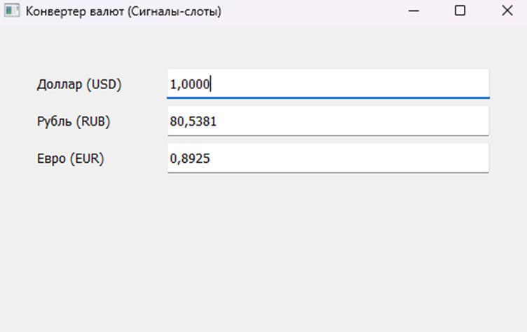
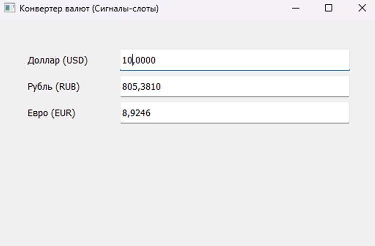
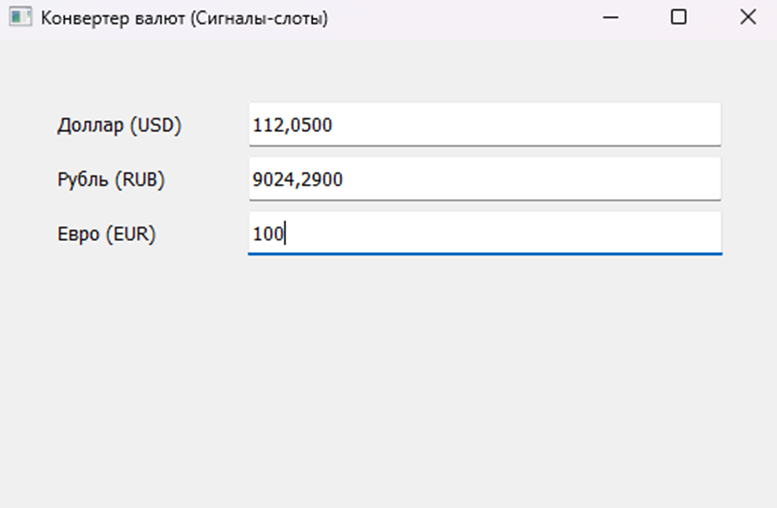
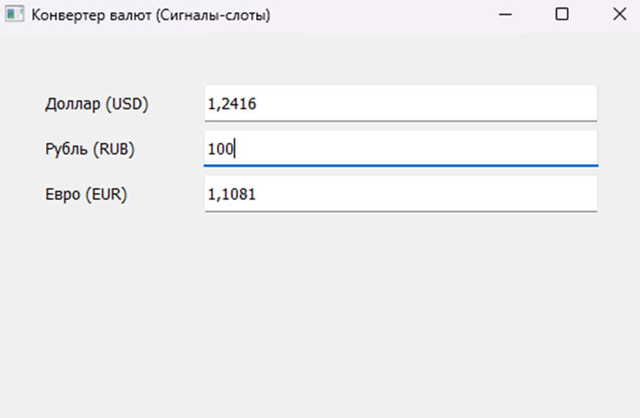

# Лабораторная работа 2

## 1 Задание
Изучить механизм сигналов и слотов в PyQt5. Нарастить функционал макета представления l2discuss, создав окно с полями ввода для конвертации валют (Доллар, Рубль, Евро). При изменении значения в одном поле, значения в остальных полях должны автоматически пересчитываться.

## 2 Описание проделанной работы

### 2.1 Начальное состояние

Размер окна: 520x320 пикселей. Минимальный размер: 240x200 пикселей. Компоненты:
1.	Три текстовых поля для ввода значений валют;
2.	Три текстовые метки для обозначения валют.

### 2.2 Используемые курсы валют

1 доллар = 80,5381 Рублей и 1 Евро = 90,2429 Рублей.

## 3 Пример работы кода

После запуска появляется окно в начальном состоянии. По умолчанию установлен 1 доллар, который автоматически конвертируется в 80,5381 рублей и 0,8925 евро:

Если изменить значение в поле Доллар (USD) на 10, остальные поля автоматически пересчитаются. Курс рублей станет 805,3810, а евро 8,9246:

Если изменить значение в поле Евро (EUR) на 100, то программа автоматически пересчитает доллары и рубли:

Если изменить значение в поле Рубль (RUB) на 100, то программа автоматически пересчитает доллары и евро:
 

